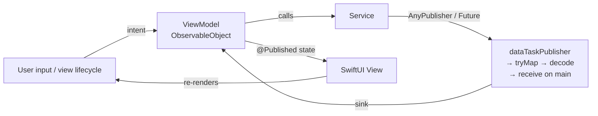
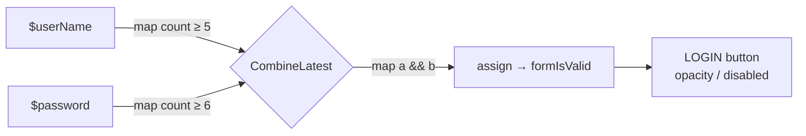
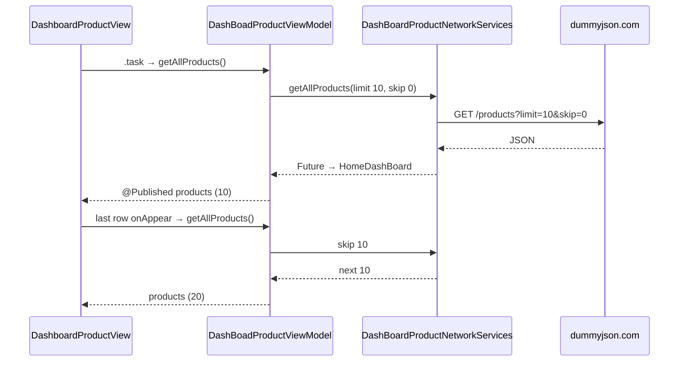
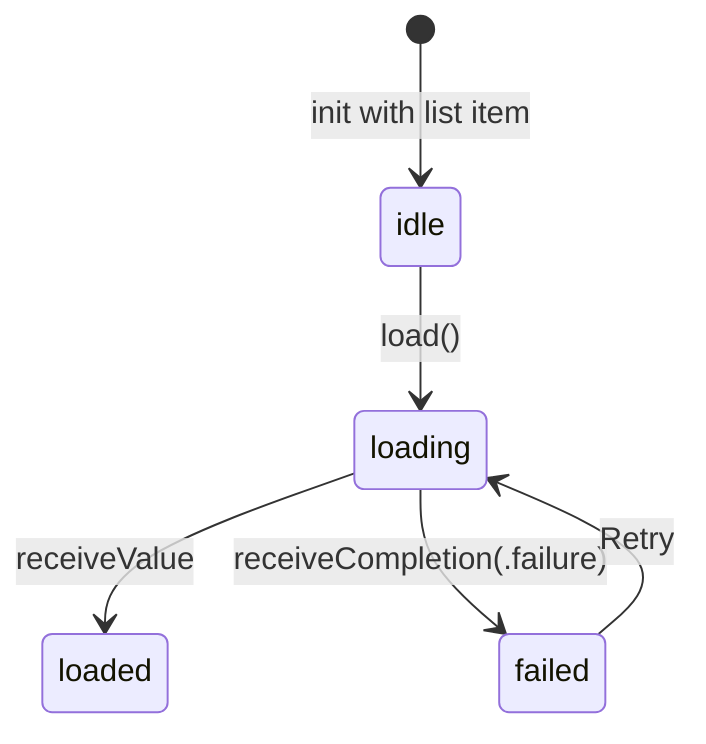

# ScenarioCover-Combine

A SwiftUI app built on **Combine** that covers real-world scenarios end to end: form validation, login, a paginated and searchable product catalog, product details, and image loading with caching. It's backed by the [DummyJSON](https://dummyjson.com) API and tested with **XCTest** (stubbed and live API tests) and **XCUITest** (page-object UI tests).

> Branch: `Stage-new`

---

## Contents

- [Features](#features)
- [Tech stack](#tech-stack)
- [Getting started](#getting-started)
- [Project structure](#project-structure)
- [How Combine drives the data flow](#how-combine-drives-the-data-flow)
  - [1. Live form validation](#1-live-form-validation)
  - [2. Login request](#2-login-request)
  - [3. Product list with infinite scroll](#3-product-list-with-infinite-scroll)
  - [4. Product details as a state machine](#4-product-details-as-a-state-machine)
  - [5. Image loading with an in-memory cache](#5-image-loading-with-an-in-memory-cache)
  - [Threading and error mapping](#threading-and-error-mapping)
  - [Operators used](#operators-used)
- [Testing](#testing)
- [API endpoints](#api-endpoints)
- [Roadmap](#roadmap)
- [License](#license)

---

## Features

| Screen | What it does | Combine at work |
|---|---|---|
| **Splash** | Animated welcome, then routes to Login or Dashboard | — |
| **Login** | Username + password with live validation, error toast on failure | `@Published` → `map` → `CombineLatest` → `assign`; `dataTaskPublisher` POST |
| **Dashboard** | Product list, 10 per page, infinite scroll, local search | `Future` wrapping `dataTaskPublisher` → `decode` → `@Published [Product]` |
| **Product details** | Image carousel, price with discount, rating, specs, reviews | `AnyPublisher<ProductDetail, NetworkError>` driving an `idle / loading / loaded / failed` state |
| **Thumbnails** | Async image loading with `NSCache` | `dataTaskPublisher` → `map(\.data)` → `compactMap(UIImage.init)` |

The login state is saved with `@AppStorage("isLoggedIn")`, so the app reopens on the dashboard after a successful login.

## Tech stack

- **Swift 5**, **SwiftUI**, **Combine**
- MVVM: `ObservableObject` view models with `@Published` state
- `URLSession.dataTaskPublisher` for networking (no third-party networking library)
- [SimpleToast](https://github.com/sanzaru/SimpleToast) 0.8.1 via Swift Package Manager
- XCTest with `URLProtocol` stubbing, and XCUITest with the page-object pattern

## Getting started

**Requirements:** Xcode 16.4 or newer (the app target's deployment target is iOS 18.6) and an iOS Simulator.

```bash
git clone -b Stage-new https://github.com/abdullah1107/ScenarioCover-Combine.git
cd ScenarioCover-Combine
open AuthUI.xcodeproj
```

Select the **AuthUI** scheme and run it (⌘R). Swift Package Manager fetches SimpleToast automatically.

**Demo login** (any user from [dummyjson.com/users](https://dummyjson.com/users) works):

| Username | Password |
|---|---|
| `emilys` | `emilyspass` |

## Project structure

```
AuthApp/
├── AuthUIApp.swift                 App entry; reads UI-test launch arguments
├── ContentView.swift               Splash → Login / Dashboard router (@AppStorage)
├── Splash/                         SplashView
├── Login/
│   ├── LoginModel/                 LoginUser (request), LoginUserResponse (accessToken or legacy token)
│   ├── LoginService/               LoginAPI (endpoint), LoginNetworkService (POST publisher)
│   ├── LoginViewModel/             Validation pipelines + login call
│   └── LoginView/                  SwiftUI form + SimpleToast
├── DashBoard/
│   ├── Model/                      HomeDashBoard, Product
│   ├── Services/                   DashBoardProductNetworkServices (paged GET)
│   ├── ViewModel/                  DashBoadProductViewModel, ImageLoader, ImageCache
│   └── View/                       DashboardProductView, ProductItemRow
├── Details/                        ProductDetailsService, ProductDetailsViewModel, ProductDetails view
├── NetworkService/                 Generic Request protocol, NetworkDispatcher, APIClient, errors
├── MockData/                       Offline JSON (users, products) + MockDataService
└── Utilities/                      Log

AuthLogicTests/                     Unit tests  (target: AuthUITests)
AuthUITests/                        UI tests    (target: AuthUIUITests)
run_tests.sh                        Build, boot a simulator, run tests
```

---

## How Combine drives the data flow

Combine models everything that changes over time as a **publisher**: keystrokes, network responses, downloaded images. **Operators** transform those values step by step, and **subscribers** (`sink`, `assign`, SwiftUI's `@Published` / `onReceive`) deliver the result to the UI.

That gives the app three properties:

1. **One direction.** Data flows *publisher → operators → view model → view*. Views never fetch data themselves; they only render `@Published` state and send intents (`getAllProducts()`, `load()`).
2. **Declarative pipelines.** Each pipeline reads top to bottom as a list of steps (validate status code → decode → switch to main thread → map errors). There are no nested callbacks.
3. **Built-in lifetime management.** Each subscription returns an `AnyCancellable`, stored in a `Set<AnyCancellable>`. When the view model is deallocated, its requests are cancelled automatically.



### 1. Live form validation

`LoginViewModel` turns the two text fields into publishers and combines them. The **LOGIN** button updates on every keystroke without any imperative `if` checks in the view.

```swift
@Published var userName = ""
@Published var password = ""
@Published var formIsValid = false

var isUserNameValidPublisher: AnyPublisher<Bool, Never> {
    $userName.map { $0.count >= 5 }.eraseToAnyPublisher()
}

var isPasswordValidPublisher: AnyPublisher<Bool, Never> {
    $password.map { $0.count >= 6 }.eraseToAnyPublisher()
}

var isSignInFormValidPublisher: AnyPublisher<Bool, Never> {
    Publishers.CombineLatest(isUserNameValidPublisher, isPasswordValidPublisher)
        .map { $0 && $1 }
        .eraseToAnyPublisher()
}

// in init:
isSignInFormValidPublisher
    .receive(on: RunLoop.main)
    .assign(to: \.formIsValid, on: self)
    .store(in: &cancellable)
```



`CombineLatest` emits whenever **either** field changes, always pairing it with the latest value of the other. That's exactly what form validation needs.

### 2. Login request

`LoginNetworkService.createUser` encodes the credentials and returns a publisher. The view model subscribes with `sink` and reports success or failure to the view.

```swift
urlSession.dataTaskPublisher(for: request)          // POST /auth/login
    .tryMap { data, response in                      // reject non-2xx
        guard let http = response as? HTTPURLResponse,
              (200...299).contains(http.statusCode) else { throw NetworkError.invalidResponse }
        return data
    }
    .decode(type: T.self, decoder: JSONDecoder())    // → LoginUserResponse
    .receive(on: DispatchQueue.main)                 // UI-safe delivery
    .eraseToAnyPublisher()
```

`LoginUserResponse` decodes DummyJSON's current `accessToken` field and falls back to the legacy `token` field, so both API versions work.

### 3. Product list with infinite scroll

`DashBoadProductViewModel` keeps the paging state. The view asks for the next page when the last row appears.

```swift
productNetworkService?.getAllProducts(
        endpoint: "https://dummyjson.com/products",
        limit: 10, skip: currentPage * 10,
        responseType: HomeDashBoard.self)
    .sink(receiveCompletion: { _ in },
          receiveValue: { [weak self] page in
              self?.products.append(contentsOf: page.products)  // @Published → List updates
              self?.currentPage += 1
              self?.isFetching = false
          })
    .store(in: &cancellables)
```



- `isFetching` guards against duplicate requests while a page is loading.
- Search is **local**: `filteredProducts` filters the already-loaded `products` with `localizedCaseInsensitiveContains`, so typing never hits the network.
- The service wraps the pipeline in a `Future<HomeDashBoard, NetworkError>`, which delivers exactly one value or one error. That fits a single request/response.

### 4. Product details as a state machine

`ProductDetailsViewModel` shows the data already loaded from the list straight away, then fetches the full record and moves through explicit states:

```swift
enum State: Equatable { case idle, loading, loaded, failed(String) }

cancellable = service.fetchProduct(id: detail.id)   // AnyPublisher<ProductDetail, NetworkError>
    .sink(receiveCompletion: { [weak self] completion in
        if case .failure(let error) = completion {
            self?.state = .failed(Self.message(for: error))   // keep list data, show banner
        }
    }, receiveValue: { [weak self] product in
        self?.detail = product
        self?.state = .loaded
    })
```



The service maps every failure into a typed `NetworkError` with `mapError`, so the view model can show a readable message (not found, offline, or bad data).

### 5. Image loading with an in-memory cache

```swift
URLSession.shared.dataTaskPublisher(for: url)
    .map(\.data)
    .compactMap { UIImage(data: $0) }      // drop data that isn't an image
    .receive(on: DispatchQueue.main)
    .sink(receiveCompletion: { _ in },
          receiveValue: { image in
              self.downloadedImage = image
              ImageCache.shared.saveImage(image, forKey: url.absoluteString)
          })
```

Each `ProductItemRow` owns an `ImageLoader` (`@StateObject`) and listens with `.onReceive(imageLoader.$downloadedImage)`. Cached images (`NSCache`) skip the network entirely.

### Threading and error mapping

| Concern | How it's handled |
|---|---|
| Background work | `.subscribe(on: DispatchQueue.global())`; `dataTaskPublisher` already runs off the main thread |
| UI updates | `.receive(on: DispatchQueue.main)` or `RunLoop.main` before any `@Published` write |
| HTTP errors | `tryMap` checks the status code and throws `NetworkError` / `NetworkRequestError` (400, 401, 403, 404, 4xx, 500, 5xx) |
| Decoding errors | `decode(type:decoder:)` → mapped to `.decodeFailed` / `.decodingError` |
| Transport errors | `URLError` → `.urlSessionFailed` |
| Cancellation | `AnyCancellable` stored in `Set<AnyCancellable>`; released with the view model |

`NetworkService/APIClient.swift` also contains a reusable, generic layer: a `Request` protocol (path, method, body, query, headers, `ReturnType`), a `NetworkDispatcher` that returns `AnyPublisher<ReturnType, NetworkRequestError>`, and `APIClient.dispatch(_:)`.

### Operators used

| Operator | Purpose in this app |
|---|---|
| `@Published` / `$property` | Turn view-model state into publishers |
| `map` | Turn text into validation booleans; extract `\.data` |
| `CombineLatest` | Merge the username and password validity |
| `tryMap` | Check the HTTP status and throw typed errors |
| `decode` | JSON → `Codable` models |
| `compactMap` | `Data` → `UIImage`, skipping failures |
| `mapError` | Normalize every failure into `NetworkError` |
| `subscribe(on:)` / `receive(on:)` | Choose the thread work runs on and the thread results arrive on |
| `eraseToAnyPublisher` | Hide pipeline types behind `AnyPublisher` |
| `Future` / `Fail` | Single-result request / immediate failure |
| `sink`, `assign`, `onReceive` | Subscribers that deliver values to the UI |
| `store(in:)` | Tie a subscription's lifetime to its owner |

---

## Testing

```bash
./run_tests.sh          # unit + UI tests
./run_tests.sh unit     # unit tests only  (AuthUITests target)
./run_tests.sh ui       # UI tests only    (AuthUIUITests target)
```

The script picks the first available iPhone simulator (override with `SIM_NAME="iPhone 16"`) and writes results to `build/TestResults.xcresult`.

**Unit tests (`AuthLogicTests/`)**

- **Stubbed API tests.** `MockURLProtocol` intercepts `URLSession` traffic, so each publisher is tested against controlled status codes and JSON. Covered: request method and URL, `accessToken` / legacy `token` decoding, 400/404/500 mapping, malformed JSON, and view-model success and failure.
- **Live API tests.** The same calls run against dummyjson.com, for example login with valid and invalid credentials, `products?limit=10&skip=10&select=title,price`, and product details with images.
- **Validation tests** for the `CombineLatest` form pipeline: username and password rules and overall form validity.

**UI tests (`AuthUITests/`)**

- The **page-object pattern** keeps tests readable: `LoginScreen`, `DashBoardScreen` and `ProductDetailsScreen` wrap elements found by accessibility identifiers (`usernameField`, `loginButton`, `productCellItem_<id>`, `productPrice`, and more).
- **Launch arguments** control state: `--uitesting` always starts logged out, and `--logged-in` skips the login screen.
- **Flows covered:** invalid and valid login, the product list loading, search, opening details (title, description, price, images), and navigating back.

## API endpoints

| Method | Endpoint | Used by |
|---|---|---|
| `POST` | `/auth/login` | `LoginNetworkService` |
| `GET` | `/products?limit=10&skip={page*10}` | `DashBoardProductNetworkServices` |
| `GET` | `/products/{id}` | `ProductDetailsService` |

Base URL: `https://dummyjson.com` (`APIConstants.basedURL`).

## Roadmap

- Reset `isFetching` and expose an error state when a page request fails, so infinite scroll can retry.
- Return `AnyPublisher` from the products service instead of wrapping a publisher in `Future`. A `Future` starts work as soon as it's created and can't be cancelled.
- Replace `.assign(to: \.formIsValid, on: self)` with `.assign(to: &$formIsValid)` to avoid a retain cycle.
- Expose login progress and errors as `@Published` state instead of a completion handler.
- Move every service onto the generic `APIClient` / `Request` layer, and remove the duplicate `MockData2` folder.
- Explore `debounce` on the search field for server-side search, and `async/await` bridging with `.values`.

## License

MIT © 2023 Muhammad Abdullah Al Mamun. See [LICENSE](LICENSE).
